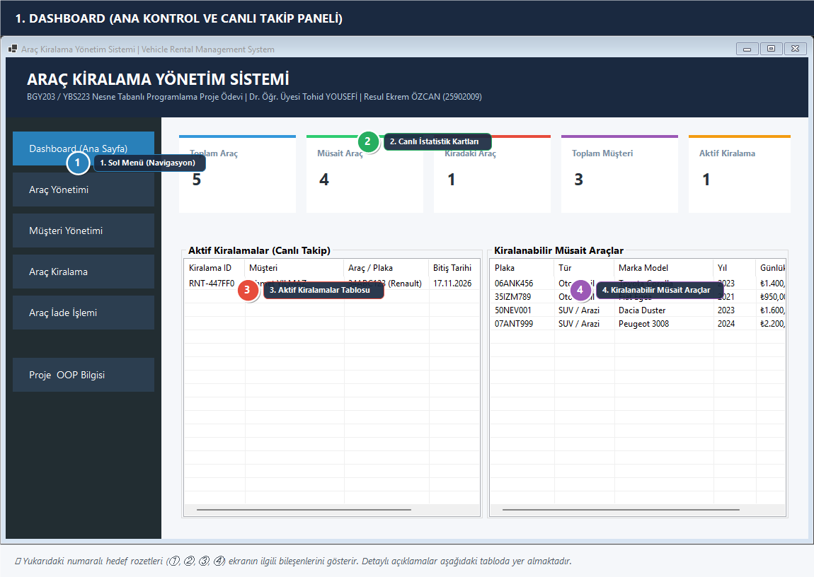
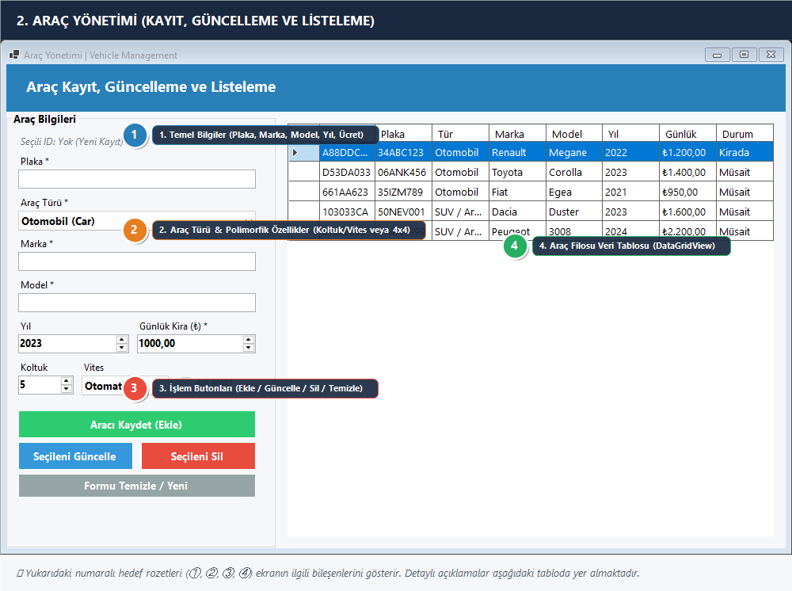
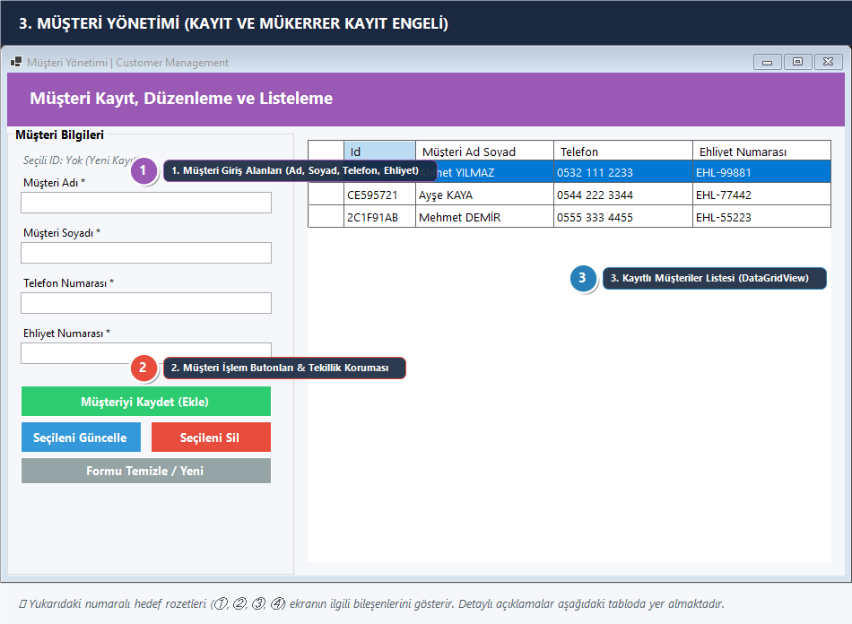
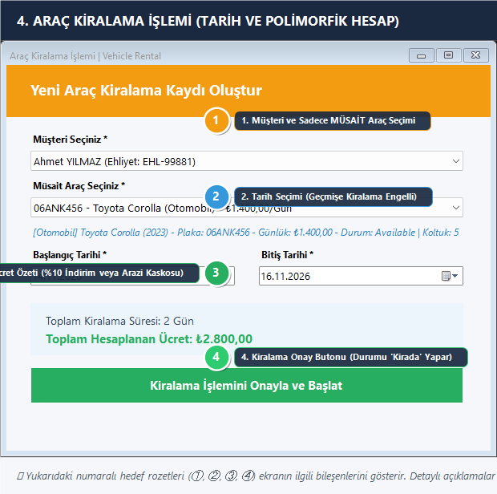
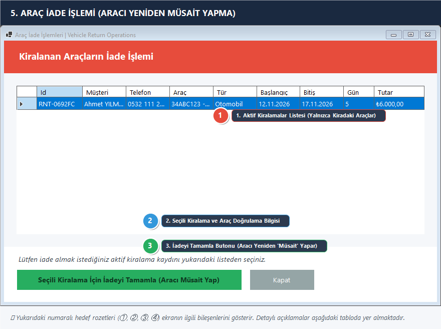
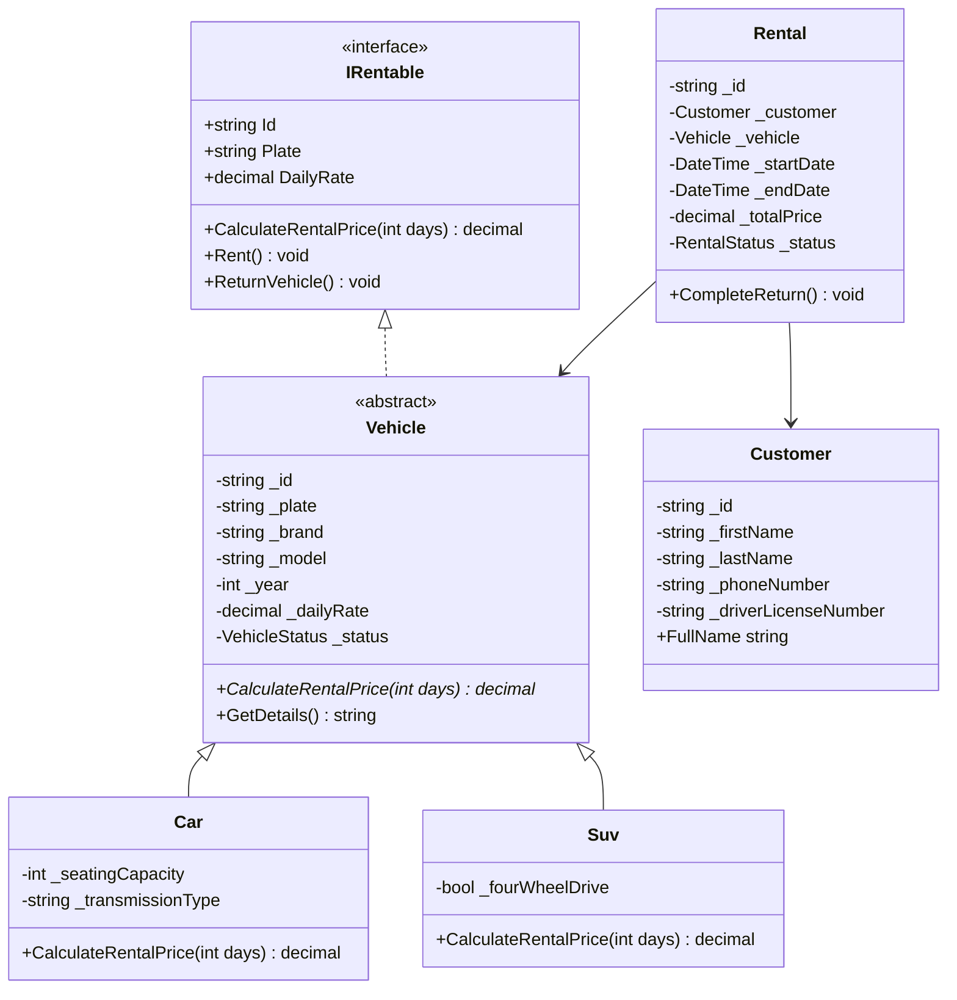

# 🚗 Araç Kiralama Yönetim Sistemi (Vehicle Rental Management System)

[](https://dotnet.microsoft.com/)
[](https://learn.microsoft.com/en-us/dotnet/csharp/)
[](https://learn.microsoft.com/en-us/dotnet/desktop/winforms/)
[](https://en.wikipedia.org/wiki/Object-oriented_programming)
[](https://kapadokya.edu.tr/)

Bu proje, **Kapadokya Üniversitesi İktisadi, İdari ve Sosyal Bilimler Fakültesi** bünyesinde yürütülen **BGY203 / YBS223 Nesne Tabanlı Programlama** dersi kapsamında, **Dr. Öğr. Üyesi Tohid YOUSEFİ** tarafından belirlenen dönem sonu teknik şartnamesine ve 100 puanlık değerlendirme kriterlerine %100 uyumlu olarak geliştirilmiş kurumsal ölçekli bir masaüstü araç kiralama yönetim sistemidir.

---

## 👨‍💻 Geliştirici ve Proje Kimliği
- **Üniversite:** Kapadokya Üniversitesi
- **Bölüm:** Bilişim Güvenliği Teknolojisi / Yönetim Bilişim Sistemleri
- **Ders Adı:** Nesne Tabanlı Programlama (BGY203 / YBS223)
- **Öğretim Elemanı:** Dr. Öğr. Üyesi Tohid YOUSEFİ
- **Öğrenci Adı Soyadı:** Resul Ekrem ÖZCAN
- **Öğrenci Numarası:** 25902009
- **Sürüm:** v1.2 Final Bug-Free Release
- **GitHub Collaborator:** `tohid.yousefi`

---

## 📸 Ekran Görüntüleri ve Adım Adım İşlevsel Kullanım Rehberi

Sistemin tüm ekranları ve üzerindeki işlevsel bileşenler, ekran görüntülerindeki numaralı hedef rozetleri (①, ②, ③, ④) ve altlarındaki açıklamalarla aşağıda detaylandırılmıştır:

---

### 1. 📊 Dashboard (Ana Kontrol ve Canlı Takip Paneli)


Dashboard ekranı, sistem başlatıldığında kullanıcıyı karşılayan ve şirketin filo operasyonlarını anlık olarak izlemeyi sağlayan canlı kumanda merkezidir. **Event-Driven Architecture (Olay Güdümlü Mimari)** sayesinde sistemde yapılan herhangi bir kiralama veya iade işlemi anında bu ekrandaki sayaçlara ve tablolara yansır.

| No | Bileşen | Çalışma Mantığı ve OOP Prensibi |
|:---:|:---|:---|
| **①** | **Sol Navigasyon Menüsü** | Araç Yönetimi, Müşteri Yönetimi, Kiralama ve İade formlarına tek tıkla geçiş sağlar. Formlar arası geçiş modal diyalog mimarisiyle güvenli şekilde yönetilir. |
| **②** | **Canlı İstatistik Kartları** | Toplam Araç, Müsait Araç, Kiradaki Araç, Müşteri ve Aktif Kiralama sayıları Generic `List<T>` koleksiyonları üzerinden LINQ sorgularıyla anlık hesaplanır. |
| **③** | **Aktif Kiralamalar Tablosu** | Şu anda müşterilerde olan araçları, kiralayan müşteriyi ve sözleşme bitiş tarihini listeleyerek gecikmeleri ve canlı durumu takip etmeyi sağlar. |
| **④** | **Kiralanabilir Müsait Filo** | Şu an boşta olan ve yeni bir sözleşmeye hazır araçları, türleri, modelleri ve günlük ücretleriyle listeler. |

---

### 2. 🚗 Araç Yönetimi (Kayıt, Güncelleme, Silme ve Listeleme)


Filoya yeni araç ekleme, var olan araç bilgilerini güncelleme, sistemden araç silme ve tüm filoyu listeleme işlevlerini yürütür.

| No | Bileşen | Çalışma Mantığı ve OOP Prensibi |
|:---:|:---|:---|
| **①** | **Temel Araç Bilgileri Alanı** | Plaka, Marka, Model, Üretim Yılı ve Günlük Ücret alanları **Kapsülleme (Encapsulation)** kurallarıyla doğrulanır. Üretim yılı 1990 ile günümüz arasında sınırlandırılmıştır; geçersiz formatlar veya 0/negatif ücretler engellenir. |
| **②** | **Çok Biçimli Araç Türü Seçimi** | Araç türü 'Otomobil' seçildiğinde Koltuk Sayısı ve Vites Türü (Otomatik/Manuel) aktif olur; 'SUV / Arazi' seçildiğinde 4x4 AWD arazi çekiş kutucuğu dinamik devreye girer (**Polymorphism**). |
| **③** | **CRUD İşlem Butonları** | Filoya araç ekleme, güncelleme ve silme işlemleri yapılır. Kirada olan veya geçmiş kiralama sözleşmesi bulunan bir aracın silinmesi sistemce engellenir (**Veri Bütünlüğü**). |
| **④** | **Filo Veri Tablosu (DataGridView)** | Kayıtlı tüm araçları durumlarıyla (Müsait / Kirada) listeler. Herhangi bir satıra tıklandığında ilgili aracın tüm bilgileri sol taraftaki form kutularına otomatik yüklenir. |

---

### 3. 👥 Müşteri Yönetimi (Kayıt, Güncelleme ve Mükerrer Kayıt Engeli)


Kurumsal ve bireysel müşterilerin sisteme kaydedildiği, iletişim ve ehliyet bilgilerinin doğrulandığı ekrandır.

| No | Bileşen | Çalışma Mantığı ve OOP Prensibi |
|:---:|:---|:---|
| **①** | **Müşteri Bilgileri Giriş Alanı** | Müşteri Adı, Soyadı, Telefon Numarası ve Ehliyet No alanları alınır. İsim ve soyisimde rakam ve özel karakter girilmesi engellenmiştir (Yalnızca alfabetik harfler kabul edilir). |
| **②** | **Müşteri İşlem Butonları & Tekillik Koruması** | Sistemde aynı ehliyet numarası, aynı telefon numarası veya aynı Ad-Soyad ile ikinci bir müşteri kaydı açılamaz (**Mükerrer Kayıt Engeli**). `000` gibi eksik veya `0000000000` gibi sahte numaralar engellenerek kullanıcıya geçerli örnek format sunulur. |
| **③** | **Müşteri Veri Tablosu (DataGridView)** | Tüm müşterileri listeler. Aktif bir kiralama sözleşmesi devam eden müşterinin silinmesi veri bütünlüğü kuralı gereğince engellenir. |

---

### 4. 📝 Araç Kiralama İşlemi (Tarih Kısıtı ve Çok Biçimli Ücret)


Müşteriye uygun müsait bir aracın seçilip sözleşmesinin bağlandığı ve nesneye özgü polimorfik ücret hesaplamasının yapıldığı ekrandır.

| No | Bileşen | Çalışma Mantığı ve OOP Prensibi |
|:---:|:---|:---|
| **①** | **Müşteri ve Sadece MÜSAİT Araç Seçimi** | Açılır listelerde yalnızca durumu `Available` (Müsait) olan araçlar listelenir. Kiradaki bir aracın mükerrer kiralanması mantıksal olarak imkansız kılınır. |
| **②** | **Geçmişe Kiralama Engeli & Tarih Doğrulama** | Başlangıç takvimi bugünden önceki tarihlere kilitlenmiştir (`MinDate = DateTime.Today`). Bitiş tarihi başlangıç tarihine endekslidir ve başlangıçtan geriye seçilemez. |
| **③** | **Polimorfik Ücret Hesaplama Paneli** | `CalculateRentalPrice` metodu ile Otomobillerde 7 gün üzeri kiralamada **%10 indirim**, SUV araçlarda 4x4 için **%25 zorunlu arazi kaskosu**, 4x2 için **%15 kasko primi** fiyata otomatik yansıtılır. |
| **④** | **Kiralama Onay Butonu** | Sözleşmeyi oluşturur, aracın durumunu anında `Rented` (Kirada) yapar ve Dashboard'daki sayaçları canlı günceller. |

---

### 5. 🔄 Araç İade İşlemi (Sözleşme Kapatma ve Aracı Müsait Yapma)


Kiralanmış ve sahada olan araçların teslim alınarak sözleşmesinin kapatılması ve aracın tekrar filoda kiralanabilir hale getirilmesi sürecini yönetir.

| No | Bileşen | Çalışma Mantığı ve OOP Prensibi |
|:---:|:---|:---|
| **①** | **Aktif Kiralamalar Listesi** | Sadece şu anda kirada olan ve teslimatı beklenen sözleşmeler listelenir. Tamamlanmış kayıtlar burada kalabalık yapmaz. |
| **②** | **Seçili Kiralama Bilgi Satırı** | Tablodan seçilen sözleşmenin müşteri adını, aracın plakasını, modelini ve tahsil edilen toplam sözleşme tutarını doğrulama amacıyla gösterir. |
| **③** | **İadeyi Tamamla Butonu** | Kiralama durumunu `Completed` yapar, aracı filoda yeniden `Available` (Müsait) durumuna çeker ve yeni kiralamalar için hazır hale getirir. |

---

## 🏛️ Nesne Tabanlı Programlama (OOP) Prensiplerinin Uygulanışı

Proje, kuramsal nesne tabanlı programlama kavramlarının tamamını gerçek bir iş mantığı üzerinde somutlaştırmıştır:



1. **Soyutlama (Abstraction):**
   - `IRentable` arayüzü ile sistemdeki kiralanabilir tüm varlıkların uyması gereken sözleşme tanımlanmıştır.
   - `Vehicle` sınıfı `abstract` olarak tanımlanarak doğrudan `new Vehicle()` ile hatalı nesne oluşturulması engellenmiştir.
2. **Kalıtım (Inheritance):**
   - `Car` ve `Suv` sınıfları ortak özellikleri `Vehicle` temel sınıfından devralarak kod tekrarını önlemiştir. Alt sınıflar `base(...)` yapıcısını çağırır.
3. **Çok Biçimlilik (Polymorphism):**
   - `CalculateRentalPrice(int days)` metodu alt sınıflarda ezilmiştir (`override`):
     - **Otomobilde:** 7 gün ve üzeri kiralamada kampanya kapsamında `%10 indirim` uygulanır.
     - **SUV'da:** Arazi kullanım riskine karşı 4x4 AWD araçlarda `%25 zorunlu arazi kaskosu`, 4x2 araçlarda ise `%15 kasko primi` otomatik eklenir.
4. **Kapsülleme (Encapsulation):**
   - Tüm veri alanları (`_plate`, `_brand`, `_dailyRate`, `_phoneNumber` vb.) `private` olarak gizlenmiştir.
   - Değer atamaları public property'lerin `set` bloklarında katı iş kurallarıyla denetlenir (Örn: Günlük ücret $\le 0$ olamaz, plaka boş olamaz, yıl 1990-2027 arası olmalıdır).
5. **İlişkisel Veri Bütünlüğü (Data Integrity):**
   - Geçmişte veya şu anda kiralama kaydı olan bir araç sistemden silinemez.
   - Aktif kiralaması devam eden müşteri sistemden silinemez.

---

## 🧪 Şartnamede Belirtilen 5 Zorunlu Test Senaryosu

Sistem, teknik şartnamede talep edilen 5 zorunlu senaryoyu otomatik ve manuel testlerde başarıyla geçmiştir:

| Test No | Test Senaryosu | Beklenen Davranış ve Doğrulama Kriteri | Durum |
|:---:|:---|:---|:---:|
| **1** | **Müsait Araç Kiralama** | Müsait durumdaki bir araç seçilip geçerli tarihlerle kiralandığında araç durumu anında `Rented` olur, sözleşme tutarı polimorfik hesaplanır. | ✅ **BAŞARILI** |
| **2** | **Çift Kiralama Engeli** | Kiralama ekranındaki açılır listede yalnızca `Status == Available` olan araçlar listelenir. Kiradaki bir aracın mükerrer kiralanması engellenir. | ✅ **BAŞARILI** |
| **3** | **Geçersiz Tarih Girişi Kontrolü** | Başlangıç tarihi bugünden öncesine kapatılmıştır. Bitiş tarihi başlangıçtan geriye seçilemez. | ✅ **BAŞARILI** |
| **4** | **Eksik veya Hatalı Bilgi Kontrolü** | Zorunlu alanlar boş bırakılamaz. Telefon en az 10 rakam, ehliyet en az 6 hane olmalıdır. Sahte/tekrarlayan numaralar reddedilir. | ✅ **BAŞARILI** |
| **5** | **İade İşlemi & Müsaitlik** | İade ekranından aktif kiralama onaylandığında sözleşme `Completed` yapılır ve araç tekrar `Available` durumuna döner. | ✅ **BAŞARILI** |

---

## 📂 Proje Dizin Yapısı (Şartname Madde 8 Uyumlu)

```text
25902009_ResulEkremOzcan_VehicleRentalSystem/
│
├── 01_SourceCode/                               # Visual Studio Solution ve Tüm Kaynak Kodlar
│   ├── VehicleRentalSystem.sln                  # Visual Studio Çözüm Dosyası
│   └── VehicleRentalSystem/
│       ├── Forms/                               # Modern Windows Forms Ekranları
│       │   ├── MainForm.cs                      # Dashboard ve Ana Kumanda Paneli
│       │   ├── VehiclesForm.cs                  # Araç Yönetimi (Ekle, Güncelle, Sil, Listele)
│       │   ├── CustomersForm.cs                 # Müşteri Yönetimi (Validasyon ve Tekillik)
│       │   ├── RentalForm.cs                    # Kiralama Sözleşmesi ve Ücret Hesabı
│       │   └── ReturnForm.cs                    # Araç İade ve Sözleşme Kapatma
│       ├── Models/                              # OOP Sınıf Modelleri
│       │   ├── Enums.cs                         # VehicleStatus ve RentalStatus Enumları
│       │   ├── IRentable.cs                     # Arayüz (Interface) Sözleşmesi
│       │   ├── Vehicle.cs                       # Soyut Temel Araç Sınıfı (Abstract Class)
│       │   ├── Car.cs                           # Otomobil Sınıfı (Inherited)
│       │   ├── Suv.cs                           # SUV / Arazi Aracı Sınıfı (Inherited)
│       │   ├── Customer.cs                      # Müşteri Sınıfı
│       │   └── Rental.cs                        # Kiralama İşlem Modeli
│       ├── Services/                            # İş Mantığı Katmanı (Business Logic Layer)
│       │   └── RentalManager.cs                 # Generic List<T> Yönetimi, CRUD, LINQ ve Eventler
│       ├── Program.cs                           # Global Hata Yakalama ve Giriş Noktası
│       └── VehicleRentalSystem.csproj
│
├── 02_Application/
│   └── Release/                                 # Derlenmiş ve Çalışmaya Hazır Masaüstü Paketi
│       ├── VehicleRentalSystem.exe              # Çift Tıklayarak Çalıştırılacak Dosya
│       ├── VehicleRentalSystem.dll
│       └── VehicleRentalSystem.runtimeconfig.json
│
├── 03_Report/
│   ├── Proje_Raporu.pdf                         # Türkçe Karakter Destekli Profesyonel Rapor (PDF)
│   ├── Proje_Raporu.docx                        # Düzenlenebilir Word Raporu (DOCX)
│   └── images/                                  # Raporda Kullanılan Oklu Görseller
│
├── 04_GitHub/
│   ├── README.md                                # GitHub Tanıtım ve Görsel Rehber Dosyası
│   ├── images/                                  # README İçin Yüksek Çözünürlüklü Görseller
│   └── GITHUB_INFO.txt                          # Depo Bilgisi ve Collaborator Detayları
│
├── images/                                      # Ana Dizin Görselleri
└── README.md                                    # Kök Dizin Bilgilendirme Dosyası
```

---

## 🚀 Projeyi Çalıştırma Yönergeleri

### 1. Hazır Derlenmiş Masaüstü Uygulaması ile (En Hızlı Yöntem)
1. `02_Application/Release/` klasörüne gidin.
2. `VehicleRentalSystem.exe` dosyasına çift tıklayarak uygulamayı anında başlatabilirsiniz. (Harici bir veritabanı kurulumu gerekmez; bellek içi yönetim sağlar).

### 2. Visual Studio ile Kaynak Koddan Çalıştırma
1. `01_SourceCode/VehicleRentalSystem.sln` dosyasını Visual Studio 2022 (veya üzeri) ile açın.
2. Üst araç çubuğundan derleme modunu `Release` veya `Debug` olarak seçin.
3. Klavyeden `F5` tuşuna basın veya `Başlat (Start)` butonuna tıklayın.

### 3. .NET CLI ile Terminalden Çalıştırma
Proje kök dizininde bir terminal veya PowerShell penceresi açarak şu komutları uygulayabilirsiniz:
```bash
cd 01_SourceCode/VehicleRentalSystem
dotnet build
dotnet run
```

---

## 📄 Lisans ve Akademik Beyan
Bu proje **Kapadokya Üniversitesi** akademik dürüstlük ilkelerine tam uyumlu olarak **Resul Ekrem ÖZCAN** tarafından eğitim ve dönem sonu proje ödevi amacıyla geliştirilmiştir. Tüm hakları saklıdır.
